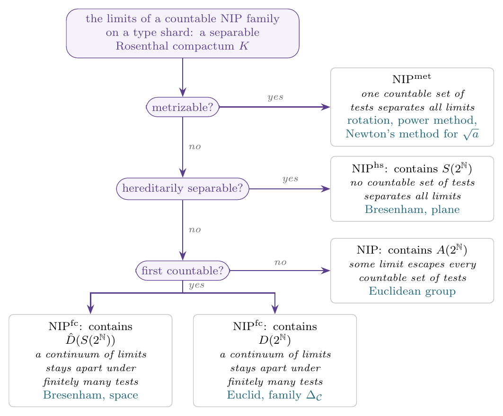
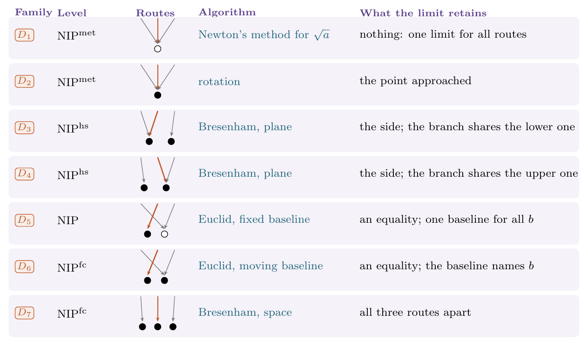

## A map of the classification

*Todorčević's trichotomy and its realizations.*

*The seven canonical families and their realizations. Arrows: departing below, along the branch, departing above; arrows ending at one dot share a limit, and an open dot is the same for every branch.*

The [interactive figures](/assets/resources/deep-computations/index.html) are on a separate page.

## Abstract

We classify the limits of computations by Todorčević's trichotomy for Rosenthal compacta, we show that its alternatives measure how many observations are needed to tell these limits apart, and we realize every alternative by a classical algorithm. Limits of continuous computations along ultrafilters, the deep computations, need not be continuous. For computation structures with countably many features whose computations extend continuously to the type shards, the completions of prescribed invariant regions of bounded states, we prove that the absence of Shelah's independence property on these regions is equivalent to the requirement that every limit of the extended computations be of the first Baire class on each type shard, and that every such limit is then the limit of a sequence of computations. For a countable family, these limits form on each type shard a separable Rosenthal compactum, which, by Todorčević's trichotomy, is metrizable or contains the split Cantor set, the Alexandroff duplicate of the Cantor set, the extended duplicate of the split Cantor set, or the Alexandroff compactification of a discrete set of the cardinality of the continuum. An observation is a test, a pair of an input and a feature. The power method has a metrizable space of deep computations; Bresenham's line algorithm yields the split Cantor set in the plane and the extended duplicate of the split Cantor set in space; the group generated by the steps of the Euclidean algorithm yields the Alexandroff duplicate and, through exact equality tests, the Alexandroff compactification. A measure-theoretic counterpart, valid for arbitrary families of features, characterizes the absence of independence by the featurewise universal measurability of all limits of the extended computations on the type shards.
